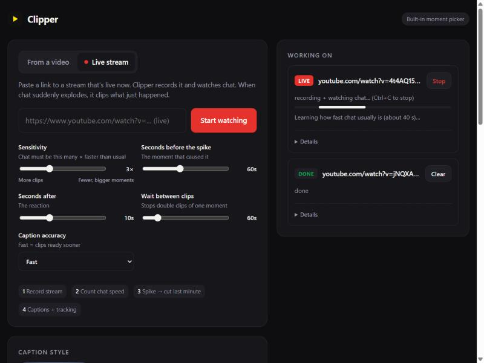

# Clipper

**Free, open-source, runs on your own computer.** Turn YouTube videos — or live streams, *while they're live* — into vertical 9:16 clips with bouncy word-by-word captions and smooth face tracking.

No subscription, no watermark, no upload limits. Change anything you like.



## What it does

**From a video** — paste a YouTube link and get the best moments as ready-to-post Shorts / TikToks / Reels.

**Live stream mode** — paste a link to a stream that's live now. Clipper records it in the background and watches the chat. When chat suddenly explodes (something just happened), it cuts the last minute and has a captioned clip ready ~1–2 minutes later. Beat everyone else to the upload.

Every clip gets:

- 🎯 **Smart moment picking** — a built-in picker (fast, punchy sections), or Claude reading the whole transcript if you add an Anthropic API key
- 💬 **Dramatic captions** — the spoken word pops in colour, loud/long words bounce harder, colours rotate per line; pick your font and colours
- 🎥 **Smooth face tracking** — the frame eases toward whoever's on screen like a camera operator and hard-cuts on scene changes (no drifting across cuts)
- ⬛ **Black-bar removal** — letterboxed / cinematic videos are cropped properly
- 🌈 **Correct colours** — prefers SDR so HDR videos don't come out grey

## Quick start

Needs **Python 3.10+**. ffmpeg is bundled automatically (via `imageio-ffmpeg`), nothing else to install.

```bash
git clone https://github.com/<you>/clipper.git
cd clipper
pip install -r requirements.txt
python ui.py
```

Your browser opens at **http://127.0.0.1:8765**. Paste a link and press **Make clips**. Finished clips appear at the bottom of the page and in the `clips/` folder.

> First run downloads the speech model (~140–460 MB depending on accuracy setting) and a small face-detection model. After that it's offline except for YouTube.

## Using it

### From a video

| Setting | What it does |
|---|---|
| How many clips | Number of best moments to cut |
| Clip length | Shortest and longest a clip may be, in seconds |
| Caption accuracy | Fast / Balanced / Best. Better = slower transcription |
| Claude (optional) | Paste an Anthropic API key for story-aware picks and clip titles. Used for that run only, never saved |

Re-running the same video is quick: the transcript is saved, so only the cutting/rendering runs again. Great for trying different caption styles.

### Live stream

| Setting | What it does |
|---|---|
| Sensitivity | A spike = chat this many × faster than usual. Lower → more clips, higher → only big moments |
| Seconds before / after | How much of what happened, and how much of the reaction, goes in the clip |
| Wait between clips | Stops one moment from producing several clips |

The panel on the right shows chat speed now vs usual and a hype bar with the clip line. It needs about a minute to learn how fast chat normally is before it can spot spikes. Press **Stop** when done — any clip being made is finished first.

### Caption style

Font, highlight colours, words on screen, and framing (**Follow faces**, or **Fit whole video** which keeps the full picture with bars above and below). The little phone preview updates as you change things. Applies to both modes.

## Command line

Everything in the UI also works from a terminal:

```bash
# best 5 clips, 30-60 s each
python clip.py "https://youtube.com/watch?v=VIDEO_ID" --clips 5 --min 30 --max 60

# local file works too
python clip.py my_video.mp4 --model base

# watch a live stream, clip on chat spikes
python live.py "https://youtube.com/watch?v=LIVE_ID" --ratio 3 --before 60 --after 10
```

Style flags for both: `--font "Impact"`, `--color FFE600,00FF66,00E5FF,FF3EA5`, `--words 3`, `--no-crop`, `--model tiny|base|small|medium|large-v3`. Run with `-h` for all options. Set `ANTHROPIC_API_KEY` in your environment to use Claude for picking.

## How it works

```
video:  yt-dlp download → Whisper (word timestamps) → pick moments → per clip:
        detect black bars → track faces (OpenCV YuNet) → smooth camera path → ffmpeg crop + ASS captions

live:   ffmpeg records the stream in 5 s chunks ─┐
        yt-dlp streams live chat → messages/sec ─┴→ spike? → join chunks around it → same clip pipeline
```

| File | |
|---|---|
| `clip.py` | Video → clips. Download, transcribe, pick, caption, track, render |
| `live.py` | Live recorder + chat spike detector, reuses `clip.py` for rendering |
| `ui.py` | Local web server (standard library only) that runs the two scripts and serves clips |
| `web/index.html` | The web UI, plain HTML/CSS/JS, no build step |

## Tests

```bash
python test_clip.py   # camera smoothing + spike detector
python test_ui.py     # server: input validation, path safety, local-only access, video seeking
```

## Good to know

- **Speed:** transcription is the slow step. It runs on your CPU unless you have an NVIDIA GPU with CUDA PyTorch, which makes it many times faster. On CPU a live clip takes ~1–2 minutes from spike to file; a long video on *Balanced* can take about as long as the video itself.
- **Live mode** works with YouTube live streams. It keeps only the last few minutes of recording on disk.
- **Privacy:** the UI only listens on `127.0.0.1`, so other devices on your network can't reach it.
- **Be fair:** only clip content you have the rights or permission to use, and follow YouTube's Terms of Service and the creator's wishes.

## License

[MIT](LICENSE) — do whatever you want, just keep the license notice.
