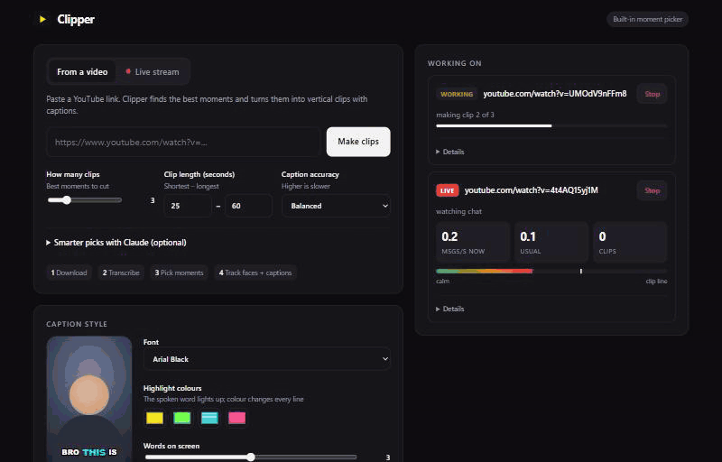
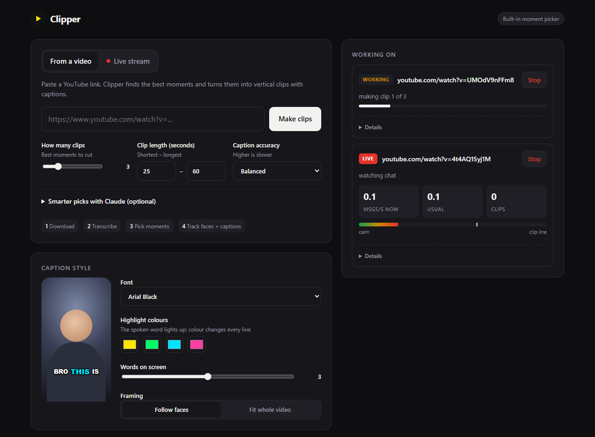
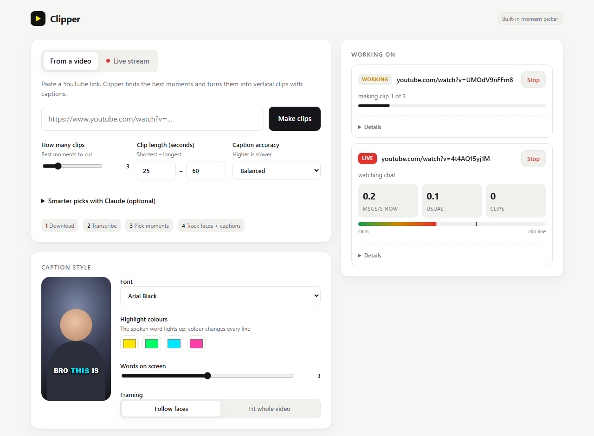
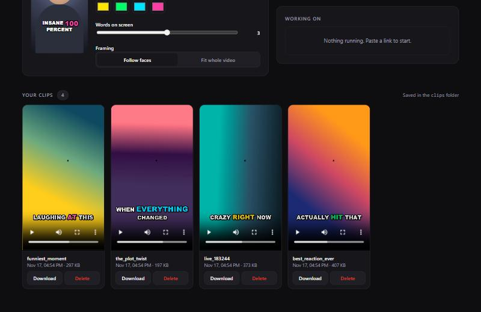
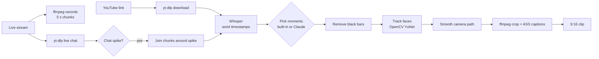

<div align="center">

# ▶ Clipper

### Turn any YouTube video — or a stream *while it's still live* — into viral vertical clips.

**Bouncy word-by-word captions · smooth face tracking · chat-spike detection**
**100% free · runs on your computer · no watermark · MIT licensed**


<sub>↑ actual caption output — the spoken word pops in colour, big words bounce harder, colours rotate every line</sub>

</div>

---

## Why Clipper?

Most clipping tools are paid, slow, and won't let you change much. Clipper does the same job on your own machine, and every part of it is a short, readable Python file you can tweak.

And it has one trick the others don't: **live mode watches a stream's chat in real time and clips the moment chat explodes** — so your clip is ready a minute or two after it happens, while everyone else is still scrubbing the VOD.

<p align="center"></p>

## ✨ Features

| | |
|---|---|
| 🎬 **From a video** | Paste a YouTube link (or use a local file) → get the best moments as 9:16 clips |
| 🔴 **Live stream mode** | Records the stream, counts chat messages/sec, and clips the last minute when chat suddenly spikes |
| 💬 **Dramatic captions** | Word-by-word, spoken word pops in colour, loud/long words bounce harder, colour rotates per line. Pick your font & colours |
| 🎥 **Smooth face tracking** | Camera eases toward whoever's talking like a real operator, ignores tiny wobble, and hard-cuts on scene changes instead of drifting across them |
| 🧠 **Smart picks** | Built-in picker for fast, punchy moments — or add an Anthropic API key and Claude reads the transcript, picks real story beats and titles each clip |
| ⬛ **Black-bar removal** | Cinematic / letterboxed videos are detected and cropped properly |
| 🌈 **Correct colours** | Downloads SDR, so HDR videos don't come out grey and washed out |
| 🖥️ **Clean web UI** | Light & dark mode, live progress, chat meter, play/download clips in the browser. Works on phones too |

## 🚀 Quick start

You need **Python 3.10+**. That's it — ffmpeg comes bundled.

```bash
git clone https://github.com/rajmaurya0904/clipper.git
cd clipper
pip install -r requirements.txt
python ui.py
```

Your browser opens **http://127.0.0.1:8765**. Paste a link, hit **Make clips**. Done.

> 💡 First run downloads the speech model (≈140–460 MB depending on the accuracy setting) and a tiny face-detection model. After that, only YouTube needs the internet.

## 🎮 Clip GTA 6 streams and videos

GTA 6 streams are full of 10-second moments people replay for years. Clipper catches them for you.

```bash
# watch a GTA 6 live stream and clip every time chat explodes
python live.py "https://youtube.com/watch?v=LIVE_ID" --ratio 3 --before 45 --after 10

# or cut the best moments from a finished GTA 6 video
python clip.py "https://youtube.com/watch?v=VIDEO_ID" --clips 8 --min 20 --max 45
```

Chat-spike detection suits gameplay well. A wild chase, a crash or a funny line makes chat spike, and Clipper cuts that moment into a captioned 9:16 clip ready for Shorts, Reels or TikTok. Only clip streams and videos you have permission to use.

## 🖼️ Screenshots

<table>
<tr>
<td width="50%"></td>
<td width="50%"></td>
</tr>
<tr>
<td align="center"><sub>Dark mode — a video job making clips while a live stream is watched</sub></td>
<td align="center"><sub>Light mode follows your system theme</sub></td>
</tr>
</table>

<p align="center"><br><sub>Your clips, playable right in the page</sub></p>

## 📖 How to use

### 🎬 From a video

| Setting | What it does |
|---|---|
| **How many clips** | Number of best moments to cut |
| **Clip length** | Shortest and longest a clip may be (seconds) |
| **Caption accuracy** | Fast / Balanced / Best — better is slower |
| **Claude** *(optional)* | Paste an Anthropic API key for story-aware picks + clip titles. Used for that run only, never saved |

Re-running the same video is fast: the transcript is saved, so trying a new caption style only re-renders.

### 🔴 Live stream

| Setting | What it does |
|---|---|
| **Sensitivity** | A spike = chat this many × faster than usual. Lower → more clips, higher → only the big moments |
| **Seconds before / after** | How much of *what happened* and how much of *the reaction* goes in the clip |
| **Wait between clips** | Stops one moment from producing several clips |

The panel shows chat speed now vs. usual and a hype bar with the clip line. It needs about a minute to learn the stream's normal chat speed. Press **Stop** when you're done — a clip in progress is finished first.

### 🎨 Caption style

Font, four highlight colours, words on screen, and framing (**Follow faces** or **Fit whole video**). The phone preview animates as you change things.

## ⌨️ Command line

Everything also works without the UI:

```bash
# 5 best clips, 30–60 s each
python clip.py "https://youtube.com/watch?v=VIDEO_ID" --clips 5 --min 30 --max 60

# a local file works too
python clip.py my_video.mp4 --model base

# watch a live stream and clip on chat spikes
python live.py "https://youtube.com/watch?v=LIVE_ID" --ratio 3 --before 60 --after 10
```

Style flags for both: `--font "Impact"` `--color FFE600,00FF66,00E5FF,FF3EA5` `--words 3` `--no-crop` `--model tiny|base|small|medium|large-v3`. Use `-h` for everything. Set `ANTHROPIC_API_KEY` to let Claude pick moments.

## ⚙️ How it works



| File | What's inside |
|---|---|
| [`clip.py`](clip.py) | Video → clips: download, transcribe, pick, captions, tracking, render |
| [`live.py`](live.py) | Live recorder + chat-spike detector (reuses `clip.py` to render) |
| [`ui.py`](ui.py) | Local web server — standard library only — runs the two scripts and serves clips |
| [`web/index.html`](web/index.html) | The whole UI: plain HTML/CSS/JS, no build step |

## 🧪 Tests

```bash
python test_clip.py   # camera smoothing + chat-spike detector
python test_ui.py     # server: input validation, path safety, local-only access, video seeking
```

## 💡 Good to know

- **Speed** — transcription is the slow part. It runs on CPU unless you have an NVIDIA GPU with CUDA PyTorch (many times faster). On CPU a live clip takes ~1–2 min from spike to file.
- **Live mode** supports YouTube live streams and keeps only the last few minutes of recording on disk.
- **Private** — the UI only listens on `127.0.0.1`; other devices on your network can't reach it.
- **Be fair** — only clip content you have the rights or permission to use, and respect YouTube's Terms of Service and creators' wishes.

## 🤝 Contributing

Issues and PRs welcome! Ideas: Twitch/Kick chat, more caption styles, GPU auto-detect, multi-speaker split-screen.

## 📄 License

[MIT](LICENSE) — free to use, change and share. Just keep the license notice.
